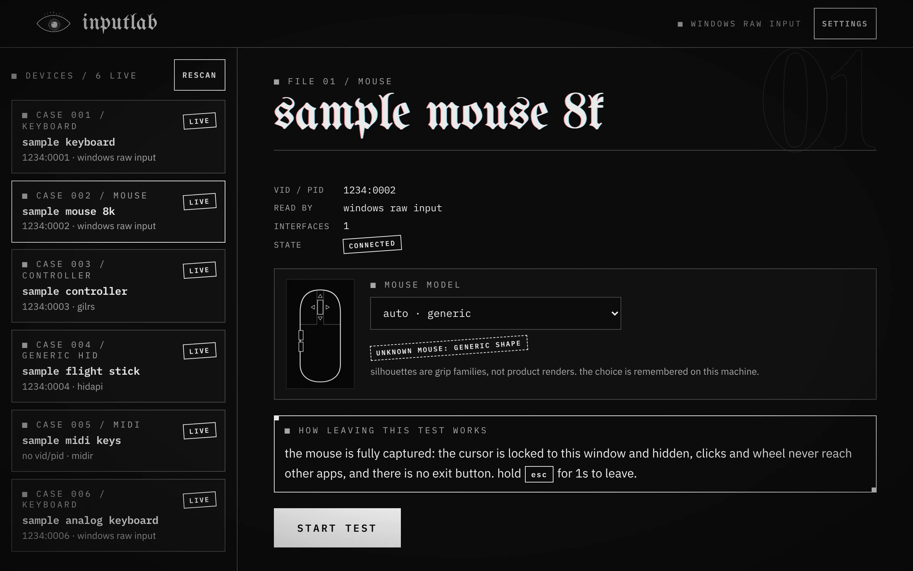
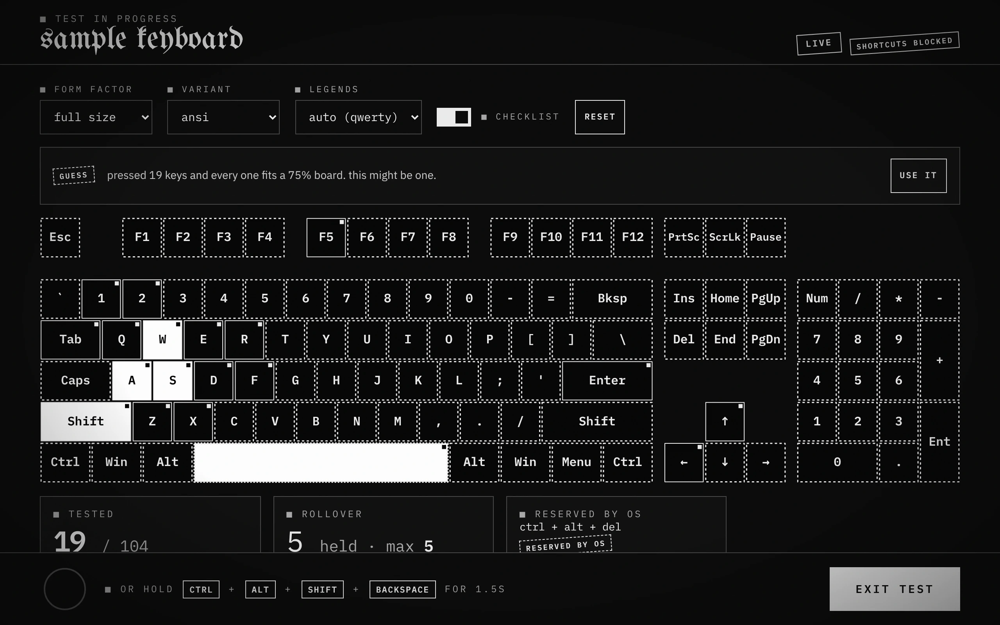
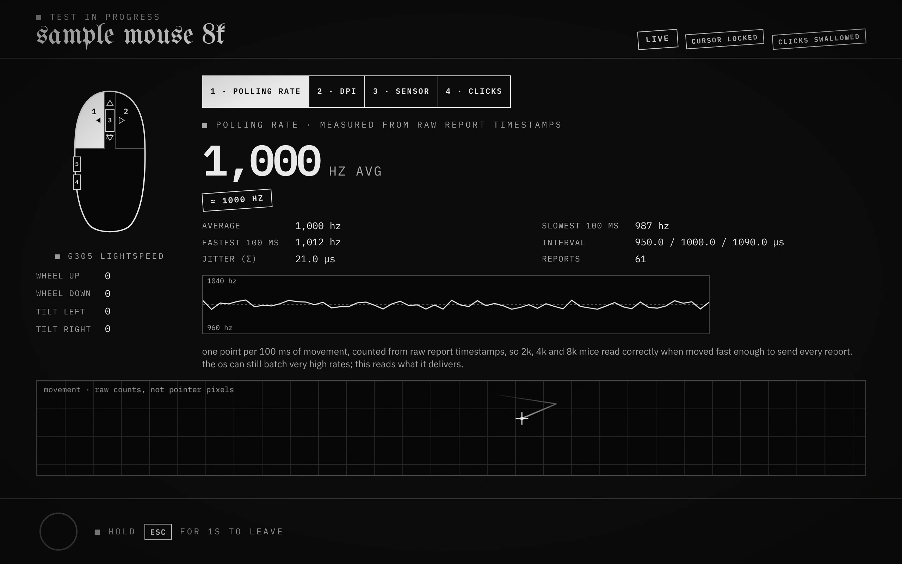
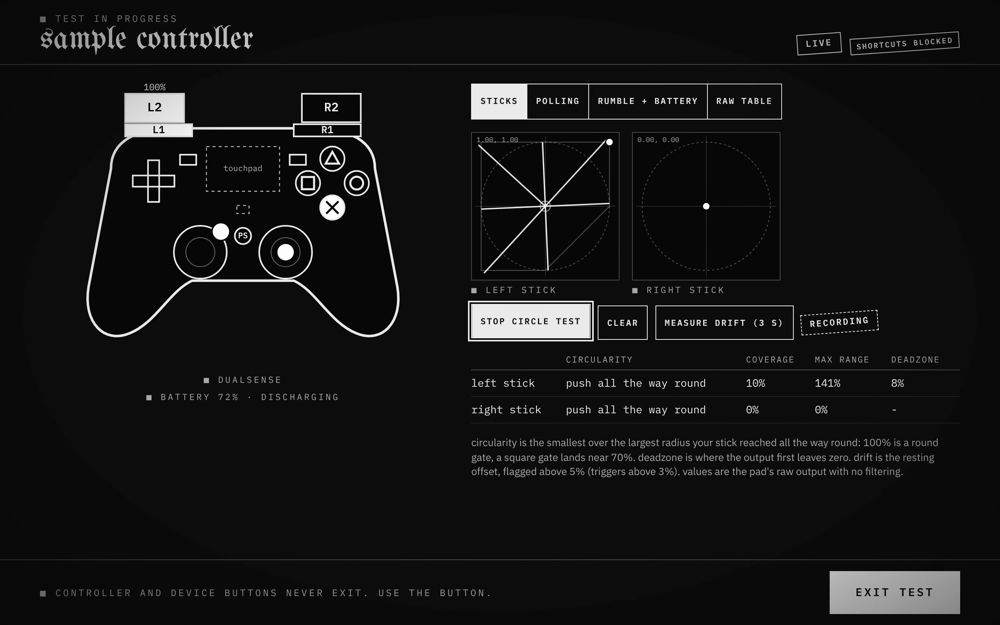

are you sick and tired of shitty keyboard testers and windows' ancient controller page? me too, so i made an app that just works.

# inputlab

a native desktop input tester. it finds every keyboard, mouse, controller, midi device and generic hid gadget on your machine, shows each one live, and measures polling rate and dpi from real raw input. no accounts, no backend, no network. everything stays on your computer.


*the real interface with generic sample data.*

| | |
| --- | --- |
|  |  |
|  | |

*real interface, generic sample data, rendered at 2x.*

## one entry per real device

windows and the hardware expose one physical device as many os interfaces: a gaming mouse can show up as a mouse, a keyboard (macros) and three vendor config channels, and windows adds its own remote-desktop and virtual inputs. inputlab folds those into one entry per physical device and hides the plumbing. a "show hidden interfaces" button at the bottom of the list brings it all back if you need it.

## what you get

- **keyboards**: an on-screen board that lights on keydown and goes dark on keyup, driven by physical scancodes (not layout characters). full, tkl, 75%, 65%, 60%, ansi and iso. a tested-keys checklist, rollover count, per-key chatter detector, hold times, and a note of which combos the os keeps for itself. analog boards (wooting profile, experimental) light by how far each key is pressed.
- **mice**: buttons 1-5, wheel up/down/tilt, a live movement trail, polling rate from raw report timestamps (live, average, slowest and fastest 100 ms, interval jitter, stability graph), a guided dpi test, a slow-circle sensor check with angle-snapping detection, and double-click chatter. the model on screen follows your mouse: a g305 and a g pro superlight are not drawn the same.
- **controllers**: a diagram that matches the pad (dualsense, dualshock 4, xbox series/one/360/elite, switch pro, generic), analog triggers that fill, live stick dots, stick circularity, deadzone and max range, resting drift, polling rate, rumble, battery, and a raw table of every control.
- **generic hid**: remotes, flight sticks, wheels, pedals, arcade sticks, tablets, odd gadgets. a live hex dump where changed bytes flash, and buttons and axes pulled from the report descriptor where it can be parsed.
- **midi**: a keyboard lit by velocity, controller meters, pitch bend, message log.
- **session summary**: json export and copy-as-text with the device, tested keys, measured polling rate and dpi.

colour rule everywhere on the test surface: **black is no input, white is active.** analog values run between the two. labels stay readable on both.

## install

grab the installer for your system from the [releases](https://github.com/ag0nyy-ops/inputlab/releases) page.

- **windows (primary)**: `.msi` or the `.exe` installer. the builds are unsigned, so smartscreen may warn the first time: more info, then run anyway.
- **macos, linux**: `.dmg`, `.AppImage` and `.deb` are built as experimental. see the status table before you rely on them.

first run: start it once with `--no-capture` (below) and look around. then try a test.

## platform support

| platform | status | what that means |
| --- | --- | --- |
| windows | primary | raw input (`WM_INPUT` on a dedicated time-critical thread that re-registers itself, because the window toolkit's own registration would otherwise replace it), low-level hooks, `ClipCursor` and a `QueryPerformanceCounter` clock are implemented. the unit tests run on a windows runner in ci and pass there, which also proves the raw input and hook code compiles on windows. the author has not yet run the lockdown paths on real hardware, so test with `--no-capture` first and report anything odd. |
| linux | experimental | evdev readers with kernel timestamps and an exclusive-grab capture. needs read access to `/dev/input` (the `input` group). runs headless in ci-style containers; not yet tried on real keyboards and mice. |
| macos | stub | devices are listed through the iokit hid manager. live keyboard/mouse input, polling and capture are not written yet. controllers, midi and generic hid use cross-platform libraries and may work. |

the frontend is only a renderer. every device read, timestamp and calculation happens in rust behind a `Platform` trait, so adding an os means implementing one file.

## the capture and exit rules

a test session captures the device under test so nothing leaks to other apps. leaving works differently by device, on purpose:

| testing | what is captured | how to leave |
| --- | --- | --- |
| a **mouse** | cursor locked to the window and hidden, clicks and wheel swallowed, no on-screen exit control at all | **hold esc** for about 1 s (adjustable in settings). a ring shows progress. nothing the mouse does can leave the session. |
| a **keyboard** | shortcuts blocked at the lowest level the os allows (esc, alt+f4, alt+tab, the win key, ctrl+w, f5, f11...) so they register as test keys. the window close button does nothing. | click the big **exit** button, **or** hold **ctrl+alt+shift+backspace** for about 1.5 s. the combo is always shown on screen, and it is read from the raw input stream in rust, from any connected keyboard, so a dead keyboard under test cannot trap you. |
| a **controller, hid or midi device** | same keyboard lockdown, mouse stays free | click the **exit** button. controller buttons never exit. |

what cannot be blocked: ctrl+alt+del, win+l and other keys the os reserves. the keyboard view lists them as *reserved by os* instead of silently missing them, and flags them if one steals focus mid-test. the fn key never reaches the os at all.

safety nets, all in rust so a frozen ui cannot trap you:

- hooks swallow input only while this window is the foreground window. the moment it is not, they pass everything through and the session ends.
- a heartbeat: if the ui stops answering for 10 s, the session is released.
- losing the window, closing the webview, a panic or quitting always releases the cursor clip, the hooks and the device grab.
- the on-screen exit button is refused by rust in mouse sessions, not only hidden.

### the failsafe: `--no-capture`

if anything ever misbehaves, start the app with `--no-capture` (or set `INPUTLAB_NO_CAPTURE=1`). nothing is clipped, hooked, swallowed or grabbed, and the exit button works in every test, mouse included.

```bash
inputlab --no-capture
```

on windows: run `inputlab.exe --no-capture` from a terminal or a shortcut with that argument. and ctrl+alt+del always works.

## how accurate are the numbers

- **polling rate** is counted in rust from the raw report timestamps (a high-resolution clock), not from animation frames, so it stays correct for 2k, 4k and 8k mice when the mouse is moved fast enough to send every report. an idle mouse sends nothing, so there is nothing to measure until you move it. the os can batch very high report rates; the app reads what it delivers and spreads batched reports evenly between their arrivals.
- **dpi** is net raw counts divided by the distance you move. raw input skips os acceleration and pointer speed, so the result is the sensor's own cpi. the real-world distance is only as accurate as your measuring: use a real ruler.
- **controller polling** comes from hid report timestamps when the pad can be opened. xinput pads and some drivers refuse, and then it counts events and says so; that is not the usb rate.
- **sensor jitter** has no pass or fail. compare it between mice and surfaces. only angle snapping gets a flag.
- **click latency** cannot be measured without a light sensor. the app measures hold time and bounce (chatter), which is what shows a failing switch.

## build from source

needs node 22, a stable rust toolchain, and the [tauri v2 prerequisites](https://v2.tauri.app/start/prerequisites/) for your os.

```bash
npm install
npm run tauri dev
```

```bash
npm run tauri build
```

on windows you also need the microsoft c++ build tools and webview2 (already on windows 11). on debian/ubuntu:

```bash
sudo apt-get install libwebkit2gtk-4.1-dev libayatana-appindicator3-dev librsvg2-dev patchelf libudev-dev libasound2-dev libssl-dev
```

## tests

```bash
npm run typecheck
npm test
cargo test --manifest-path src-tauri/Cargo.toml --lib
```

the rust tests cover the exit rules (including the combo from a second keyboard and the controller-never-exits rule), the threaded engine against a fake platform that records every capture and release call, polling math from 125 hz to 8000 hz, the dpi and sensor math, the hid descriptor parser, and the device merge logic. the ui checks run in a browser against a development-only mock backend (`?empty=1`, `?state=offline`, `?many=1`, `?nocapture=1`, `?analog=1`), which never ships in release builds.

### what needs real hardware

these cannot be proven from a code review or a container. if you have the hardware, please check:

- the windows lockdown end to end: esc-hold in a mouse session, the exit button and the combo in a keyboard session, alt+tab and the win key during a session, the window close button, and focus loss.
- whether raw input still reports keys and clicks while the low-level hooks swallow them (the code detects the case where it does not and falls back to the hook as the key source, but it has not met a real machine).
- 4k and 8k mice, analog keyboards (the wooting report format is written from memory and marked unverified), specific controllers (dualsense, switch pro, xinput pads), battery and rumble.

## adding things

**a keyboard layout** lives in `src/layouts/build.ts`. a layout is rows of keys in key units, built with a small row helper: `r.k('KeyA')`, `r.k('Enter', 2.25)`, `r.gap(0.25)`. add a size to `Size` and describe it in `buildLayout`; the layout tests check that no key overlaps another and none is duplicated. legends for another keyboard language go in `src/layouts/labels.ts` as overrides on top of qwerty.

**a mouse model** is one row in `src/models/mice.ts`: a name pattern and one of the grip shapes in `src/models/mouseShapes.ts`. a new shape is one outline path plus a few numbers (button split, wheel box, side buttons). wireless receivers are shared by several mice, so those ask the user once and remember it.

**a controller** is one row in `src/models/pads.ts` (usb ids and a name pattern) and, if its layout is new, a layout in `src/models/padLayouts.ts` naming which control lights which part.

**an analog keyboard profile** is a struct implementing `AnalogProfile` in `src-tauri/src/hid/analog.rs`: recognise the analog interface in `detect`, turn a report into `(key, depth 0..1)` in `parse`, and list it in `profile`. anything without a profile still gets the raw report dump.

**a generic hid device** needs nothing: if the os gives up a report descriptor, buttons and axes appear on their own. if not, the raw hex dump is still live.

**another os** means implementing the `Platform` trait in `src-tauri/src/platform/`.

## project layout

```
src-tauri/src/
  platform/   os raw input + capture behind one trait (windows, linux, macos stub)
  devices/    device list merge, hot-plug hub, gilrs and midi
  hid/        hidapi enumeration, report reader, descriptor parser, analog profiles
  capture/    session modes and the exit rules (pure logic, unit tested)
  timing/     monotonic clock, polling, dpi, sensor, key, stick math
  commands/   the tauri commands
  engine.rs   the one active session: events in, batched frames out
src/
  views/      keyboard, mouse, controller, hid, midi, summary, settings
  layouts/    keyboard layouts as data
  models/     mouse and controller catalogs and drawings
  lib/        bridge, store, drawing, export
```

## releases

pushing a tag like `v0.1.0` (or running the workflow by hand with a version) runs `.github/workflows/release.yml`, which builds the windows `.msi` and `.exe` (plus experimental macos and linux bundles) and attaches them to a draft release. ci (`ci.yml`) runs the frontend checks and the rust tests on linux and windows for every push and pull request.

## privacy

there is no network code, no telemetry, no account. the webview's content security policy allows nothing but the app itself. the optional json export holds what was measured and the device's name and usb ids; nothing is sent anywhere.

## fonts and licence

the source is viewable, not reusable: you may read it, learn from it, run it and build your own app, but you may not copy the project or pieces of its code. the full terms are in [LICENSE](LICENSE). it is a custom licence, not an open-source one.

the ui uses UnifrakturMaguntia, IBM Plex Mono and IBM Plex Sans, self-hosted, under the SIL Open Font License 1.1. the licence texts are in `public/licenses/`.
